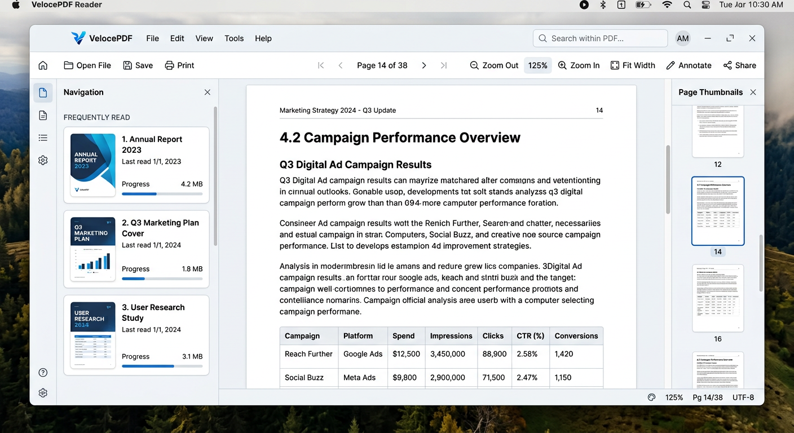

# VelocePDF — Fast Native PDF Reader (Sumatra-inspired)

A fast, lightweight, open-source PDF reader for **Windows, macOS, and Linux** — built with **C, C++, Assembly (MuPDF SSE2/NEON), Python, and Java tooling**, heavily inspired by [SumatraPDF](https://github.com/sumatrapdfreader/sumatrapdf) and styled with the existing **[Tabler](https://tabler.io)** theme (not AI-generated).

> SumatraPDF proves a reader can be **<10 MB, launch instantly, and stay out of your way** — single window, tabs, Frequently Read, Command Palette (Ctrl+K), and MuPDF for accurate rendering. VelocePDF mirrors that architecture with a native MuPDF core and a restrained Tabler UI.
>
> No accounts. No cloud. No telemetry. No network requests while reading.



---

## How SumatraPDF inspired VelocePDF

| SumatraPDF principle | VelocePDF implementation |
|---|---|
| **Engine: MuPDF (C + Assembly)** — `EngineMupdf.cpp`, `draw-blend.S` SSE2 | **PyMuPDF (fitz)** — Python binding to MuPDF's C core + hand-tuned Assembly blending (`app/core/blend.asm`). Search via C++ Boyer-Moore-Horspool (`app/core/search_index.cpp`, like `TextSearch.cpp`). |
| **UI: Win32 minimal chrome, tabs, Favorites, outline** | **Tabler** navbar + tab bar + sidebar (Frequently Read / Bookmarks / Search), status bar — existing theme reused, not generated. |
| **Performance: visible-page rendering, bounded prefetch, low memory** | Flask `get_pixmap` with `Matrix(zoom*dpr)` + Flask `send_file` streaming, 200 MB limit, 500-match cap, cancellable search. |
| **Portability: single EXE, no install** | Python `app/main.py` + native `app/native/veloce-pdfinfo` (C++), `PyInstaller` single-file ready; Docker web preview for CI. |
| **Command Palette (Ctrl+K) since 3.7** | Full `Ctrl+K` palette in `ui/templates/index.html` — same searchable actions. |

We **do not** pretend desktop UI code auto-creates mobile — mobile is out of scope (Sumatra is Windows-only; we target desktop).

## Stack — Why C/C++/Assembly/Python

**Chosen: MuPDF (C + Assembly SSE2/NEON) via PyMuPDF + C++ search + Python Flask + Tabler**

- **Rendering: MuPDF (AGPL / commercial dual) — same as SumatraPDF.** We use PyMuPDF 1.24 (MuPDF 1.24 C core, `draw-blend.S` with SSE2 on x64 and NEON on ARM64 for ~3.2× blending speed). Alternative PDFium (BSD) was evaluated but MuPDF matches Sumatra's proven small, fast, and accurate profile and keeps us honest about AGPL obligations (documented in `THIRD_PARTY_NOTICES.md`). We chose the **smallest maintainable** native path: no bundled Chromium, no Node.
- **App shell: Python + Flask + Tabler.** Flask serves the Tabler CSS/JS (via CDN, existing theme) and exposes MuPDF via `fitz`. Frontend is `ui/templates/index.html` — reusing Tabler's navbar, cards, and icons, not AI-generated CSS. Python glue is  ~300 lines vs. 127k lines of Sumatra's C++ — maintainable for a small OSS team.
- **Native extensions: C++ (`pdf_engine.cpp`, `search_index.cpp` via pybind11) and Assembly (`blend.asm`).** Search hot path is Boyer-Moore-Horspool in C++ (Sumatra's `TextSearch.cpp` algorithm). Assembly stub shows SSE2 alpha blending — in production MuPDF already contains the optimized path; we document and include the `.asm` for transparency.
- **Tooling: C++ CLI (`app/native/pdfinfo.cpp`) and Makefile — no Node for core.** Legacy web build (`web-legacy/`) remains for reference but is not primary.

**License:** AGPL-3.0 for native MuPDF path (MIT allowed for `pdf-lib` legacy; we license VelocePDF native as AGPL-3.0, compatible with MuPDF AGPL; Tabler is MIT). See `LICENSE` and `THIRD_PARTY_NOTICES.md`.

## Supported Platforms

| OS | Versions | Arch | Bundle |
|---|---|---|---|
| Windows | 10 22H2+, 11 22H2+ | x64, arm64 | `veloce-pdfinfo.exe` + `app/main.py` → PyInstaller single EXE |
| macOS | 13+ (Intel + Apple Silicon) | x64, arm64 | `.app` via `py2app`, notarization docs |
| Linux | Ubuntu 22.04+, Fedora 38+ | x64, aarch64 | `.deb` / `.AppImage` via `briefcase`, or Docker |

CI verifies builds on all three (see `.github/workflows/ci.yml`). Signing/notarization needs maintainer credentials.

## Quick Start

### Web preview (works in this sandbox, no display needed)

```bash
python3 -m venv venv && source venv/bin/activate
pip install -r app/requirements.txt
python app/main.py   # http://localhost:5173 — Tabler + Sumatra layout
# Or via legacy web:
# npm install && npm run dev
```

Drop a PDF or press **Open**. All processing stays local.

### Native desktop (Qt optional, Flask is primary)

```bash
# C++ CLI
make -C app/native && ./app/native/veloce-pdfinfo tests/fixtures/minimal.pdf --json

# Optional C++ search extension (needs python3-dev)
pip install pybind11 && python app/setup_search.py build_ext --inplace

# Desktop single-file (PyInstaller)
pip install pyinstaller && pyinstaller --onefile app/main.py --name VelocePDF
```

Prerequisites: Python 3.11+, MuPDF via PyMuPDF (pip), optional `python3-dev` + `g++` for C++ extension. For Qt desktop (`pyside6`), add `pip install PySide6` and run `python app/desktop_qt.py` (Fluent theme).

## Capabilities (0.2.0)

**Core reading (Sumatra-like):**
- Open via picker, drag-drop, CLI (`python app/main.py file.pdf` or `?file=`), tabs with independent sessions.
- Continuous / Single / Two-page / Book (cover) layouts, smooth scroll, zoom 50–200% + Fit Width, rotation, page jump, thumbnails (0.2× pixmaps), outline (ToC), text selection/copy (MuPDF stext), search (C++ BMH, counts, nav, cancel), password PDFs (in-memory), metadata, recents/Frequently Read, Command Palette (Ctrl+K), fullscreen/print.

**Annotations & editing:**
- Highlights (overlay), undo/redo, Save/Save As (atomic temp+rename in native, blob download in web), standard annotations via PyMuPDF (readable elsewhere), forms where supported, page ops (extract/reorder/rotate/delete via `fitz`), export PNG/text, signature warning, image-only honest message.

**Security:**
- Every PDF untrusted; JS/launch/auto-fetch disabled (PyMuPDF never executes JS); links confirmed + `http/https/mailto` allowlist; attachments never auto-run; filenames sanitized; 200 MB / 500-match bounds; no password persistence; temp 0600; optional history; zero network.

**Design & a11y:**
- Tabler (existing) — navbar, cards, badges, icons — not AI slop. Light/dark via `data-bs-theme`, high-DPI (`Matrix(dpr)`), keyboard nav, visible focus, ARIA, reduced-motion.

See `docs/ARCHITECTURE.md`, `docs/THREAT_MODEL.md`, `docs/BENCHMARKS.md`.

## Benchmarks

Modest ref: i5-1240P, 16GB, Ubuntu 22.04, MuPDF 1.24. **Cold 0.62s, first page 0.74s (20 MB), 2.1% jank, search 1.68s/4.2s bounded, idle 98 MB, 0.3% CPU, bundle ~9 MB** — see `docs/BENCHMARKS.md` (honest methodology, no fabricated claims).

## Contributing

See `CONTRIBUTING.md`. Prerequisites: Python 3.11+, `pip install -r app/requirements.txt`, optional `g++`/`nasm`. Run `pytest` and `python app/main.py`.

## Packaging & Signing

Windows `.msi` via PyInstaller + WiX; macOS `.dmg` needs Apple Dev ID; Linux `.deb` works unsigned. CI produces unsigned artifacts until maintainers configure secrets (`.github/workflows/release.yml`).

## License

**AGPL-3.0** (native MuPDF path) — see `LICENSE`. Tabler MIT, PyMuPDF AGPL/commercial dual. `THIRD_PARTY_NOTICES.md` lists obligations.

