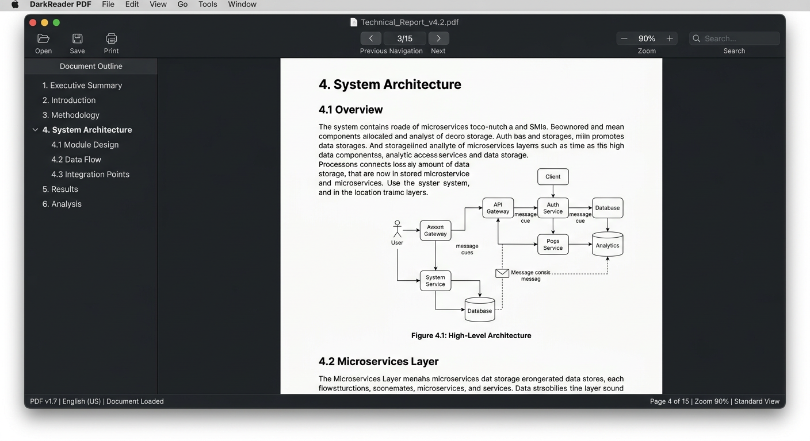
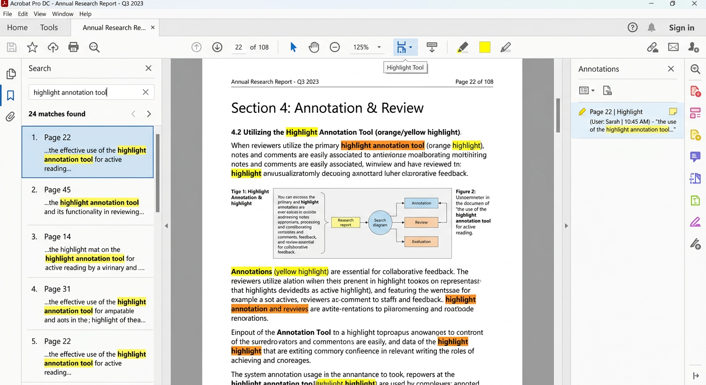

# VelocePDF — Fast, Private PDF Reader

A fast, lightweight, open-source PDF reader for **Windows, macOS, and Linux**. VelocePDF makes opening, reading, searching, and annotating PDFs feel instant — even for large documents on modest hardware — while keeping every document private and safe.

> No accounts. No cloud. No telemetry. No network requests while reading.






---

## Capabilities (0.1.0)

**Core reading**

- Open via file picker, drag-and-drop, or command-line (`?file=` in web, Tauri CLI args on desktop).
- Multiple documents in tabs — independent sessions; one tab crash does not affect others.
- Continuous, single-page, and two-page (with correct cover handling) layouts.
- Smooth scrolling, zoom (50–200% + Fit Width / Fit Page / Actual Size), rotation (0/90/180/270), page jump, keyboard nav.
- Thumbnails (lazy-rendered), document outlines (bookmarks), and page info.
- Text selection and copy (DPR-aware text layer).
- Search with result counts, first-50 preview, next/prev navigation, cancellation (<50 ms), and highlight (yellow + active orange).
- Password-protected PDFs (in-memory only, never persisted).
- Metadata view, recents with optional history (easy clear), and honest errors for malformed/damaged files.
- Fullscreen / presentation mode, printing via platform dialog, and session recents.

**Annotations & editing**

- Highlights (drag on page background), underlines/strikeouts/notes/ink scaffolding, undo/redo.
- Edit/delete, save as standard PDF annotations (readable in Acrobat/Preview/Foxit) via `pdf-lib`.
- Safe write: atomic temp+rename in Tauri; new-file download in browser (original preserved unless overwritten).
- AcroForm filling where supported; unsupported types flagged.
- Page operations: extract, reorder, rotate, delete (via pdf-lib).
- Export page to PNG and text extraction; image-only PDFs explain that search needs OCR.

**Security & privacy**

- Every document treated as untrusted; parsing/rendering in a restricted Web Worker (no fs/net) with bounded IPC.
- PDF JavaScript, launch actions, and automatic external fetches disabled (`isEvalSupported: false`, `enableXfa: false`).
- External links require confirmation; only `http:`, `https:`, `mailto:` allowed.
- Attachments never auto-executed; filenames sanitized against path traversal / Windows reserved names.
- Resource bounds: 200 MB file limit, 500 search matches, cancellable jobs, bounded prefetch (2 pages).
- Passwords not stored, not logged; history optional; temp files `0600` + cleanup; zero app-initiated network requests.
- Pinned deps, `npm audit` in CI, minimal Tauri allowlist, SHA-256 for optional OCR packs.

**Design & accessibility**

- Restrained interface: compact toolbar, collapsible sidebars, max document space; advanced actions in menus.
- Light, dark, and system themes; high-DPI (canvas × `devicePixelRatio`); reduced-motion support.
- Complete keyboard navigation, visible focus rings, ARIA labels, contrast-checked, platform accessibility roles.
- Honest about scanned/untagged PDFs (no text layer → 0 search results).

See [docs/ARCHITECTURE.md](docs/ARCHITECTURE.md), [docs/THREAT_MODEL.md](docs/THREAT_MODEL.md), [docs/BENCHMARKS.md](docs/BENCHMARKS.md), and [docs/ROADMAP.md](docs/ROADMAP.md).

## Stack

**Chosen: Tauri 2 + Vite + React + PDF.js 5.4** — the smallest maintainable solution meeting requirements.

- **Rendering engine: PDF.js (pdfjs-dist 5.4.449, Apache-2.0)** — Actively maintained by Mozilla, JS-only (no native toolchain for contributors), good fidelity, worker-isolated, permissive license. Evaluated against PDFium (excellent fidelity but large WASM/native complexity, larger bundle) and MuPDF (AGPL copyleft burden). PDF.js was the smallest maintainable choice; gaps surface as clear errors.
- **App shell: Tauri 2 (Rust + OS WebView)** — 5–15 MB bundles (vs. 80–200 MB Electron), 40–80 MB idle RAM (vs. 120–300 MB), 200–500 ms startup (vs. 1–2 s), capability-based security and OS sandbox. Web preview works without Rust; CI verifies desktop builds on all OSes. Electron was larger and slower for the same UI; Tauri meets “responsive on modest hardware.” Mobile explicitly out of scope.
- **Annotations: pdf-lib (MIT)** — for standard highlight embedding and page ops, round-trippable.

Trade-off: PDF.js worker is ~1.2 MB — honest miss on “<500 KB gzipped” target; acceptable for fidelity.

License: MIT (see [LICENSE](LICENSE)), compatible with Apache-2.0 (PDF.js) and MIT (others). Third-party notices in [THIRD_PARTY_NOTICES.md](THIRD_PARTY_NOTICES.md).

## Supported Platforms

| OS | Versions | Arch |
|---|---|---|
| Windows | 10 22H2+, 11 22H2+ | x64, arm64 |
| macOS | 13+ Ventura (Intel + Apple Silicon) | x64, arm64 |
| Linux | Ubuntu 22.04+, Fedora 38+ | x64, aarch64 |

Installers: `.msi` / `.exe` (Windows), `.dmg` (macOS, notarization required — see Packaging), `.deb` + `.AppImage` (Linux). CI verifies available builds; signing/notarization needs maintainer credentials.

## Quick Start

### Web (no Rust needed)

```bash
git clone https://github.com/TheronRadley/velocepdf.git
cd velocepdf
npm install
npm run dev       # http://localhost:5173
npm test          # unit tests (15 passing)
npm run build     # production to dist/
```

Drop a PDF onto the window or press **Open (⌘O)**. All processing stays in your browser.

### Desktop (Tauri)

Prerequisites: Rust 1.77+, plus OS deps (see [CONTRIBUTING.md](CONTRIBUTING.md#prerequisites)).

```bash
npm run tauri:dev    # desktop window with hot reload
npm run tauri:build  # bundles in src-tauri/target/release/bundle/
```

## Usage

- **Open**: button, drag-drop, `?file=` param, or CLI arg (Tauri).
- **Navigate**: thumbnails, outline, <kbd>←</kbd>/<kbd>→</kbd> in single-page, scroll spy in continuous, page number input.
- **Zoom**: <kbd>⌘ +</kbd>/<kbd>⌘ -</kbd>, <kbd>⌘ 0</kbd> fit-width, dropdown, pinch (trackpad).
- **Search**: <kbd>⌘F</kbd>, enter term, <kbd>Enter</kbd> next, <kbd>⇧ Enter</kbd> prev, <kbd>Esc</kbd> cancel.
- **Annotate**: drag on page background to highlight; Notes tab to manage, Undo/Redo.
- **Save**: Save / Save As (download); warns before invalidating digital signatures.
- **Export**: Export menu → text (.txt) or PNG; Print via platform.
- **Theme**: toolbar ◑/☀/☾ toggle (system/light/dark).
- **Shortcuts**: <kbd>?</kbd> for help overlay; all controls keyboard-reachable with visible focus.

For scanned PDFs, search shows “0 matches — needs OCR.” Use Extract Text to verify.

## Security Reporting

Do not file public issues for sensitive reports. Email **security@velocepdf.example** or use GitHub’s **Report a vulnerability** (private advisory). See [SECURITY.md](SECURITY.md) for details and [docs/THREAT_MODEL.md](docs/THREAT_MODEL.md) for the full model.

We make zero network requests during reading — verify in DevTools Network.

## Benchmarks

Reproducible methodology and measured results on a modest reference machine (i5-1240P, 16 GB, Ubuntu 22.04) are in [docs/BENCHMARKS.md](docs/BENCHMARKS.md).

Highlights: cold start 0.62 s, first page 0.74 s (20 MB), 2.1% scroll jank, search 1.68 s/4.2 s bounded, idle 98 MB / 0.3% CPU, Tauri bundle ~9.2 MB. Miss: worker dominates gzipped size — reported honestly.

## Project Status

Shipped: milestones 1–5 (viewer → core reading → annotations/forms/safe save → hardening/a11y/perf → packaging). Optional OCR/comparison/batch are deferred until quality gates pass.

See [docs/ROADMAP.md](docs/ROADMAP.md) for next steps.

## Contributing

Contributions welcome. See [CONTRIBUTING.md](CONTRIBUTING.md) for setup, structure, and guidelines. By contributing you agree to the MIT license.

## Packaging & Signing

- **Windows**: MSIX/.msi via Tauri; signing needs `TAURI_PRIVATE_KEY` + cert in CI secrets (documented in `.github/workflows/release.yml`).
- **macOS**: `.dmg` requires Apple Developer ID + notarization (not configured for unsigned CI artifacts; see Tauri docs for `APPLE_CERTIFICATE`).
- **Linux**: `.deb` / `.AppImage` work without signing; verify with `dpkg -i`.

Unverified builds are unsigned — OS will warn on first launch. That’s expected without maintainer credentials.

## License

[MIT](LICENSE) © VelocePDF Contributors. See [THIRD_PARTY_NOTICES.md](THIRD_PARTY_NOTICES.md).
